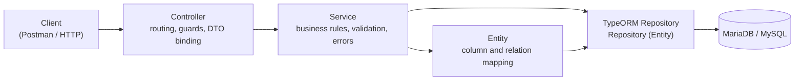
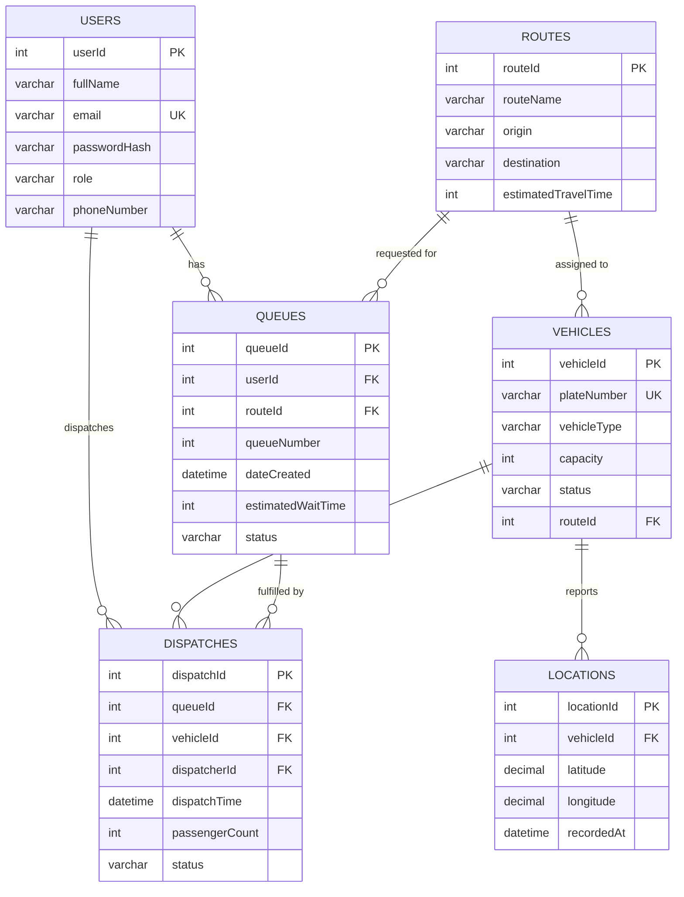

# Project Sakay

Project Sakay is a NestJS REST API for managing a small public-transport operation. It keeps track of commuters, drivers, dispatchers and administrators, the vehicles and routes they use, the queue of waiting passengers, dispatch records, and the last reported GPS location of each vehicle.

The API is backed by a MySQL-compatible database (MariaDB in the development environment) through TypeORM, and protected by JWT authentication with role-based authorization.

---

## Table of Contents

- [Project Overview](#project-overview)
- [Features](#features)
- [Technology Stack](#technology-stack)
- [System Architecture](#system-architecture)
- [Project Structure](#project-structure)
- [Prerequisites](#prerequisites)
- [Installation and Setup](#installation-and-setup)
- [Environment Variables](#environment-variables)
- [Database Design](#database-design)
- [Authentication and Authorization](#authentication-and-authorization)
- [API Documentation](#api-documentation)
- [Postman Testing](#postman-testing)
- [Error Handling and Validation](#error-handling-and-validation)
- [Available Scripts](#available-scripts)
- [Development Notes](#development-notes)
- [Future Improvements](#future-improvements)

---

## Project Overview

### What it does

Project Sakay exposes a REST API for the day-to-day records of a transport terminal or fleet:

- Registering and signing in users.
- Assigning roles to users.
- Recording routes and the vehicles assigned to them.
- Recording passenger queues per user and route.
- Recording dispatches that combine a queued passenger record, a vehicle, and a dispatcher.
- Recording vehicle GPS coordinates.

### Problem it addresses

It centralizes records that would otherwise be kept in separate spreadsheets or logbooks: who is waiting, on which route, which vehicle is available, who dispatched it, and where the vehicle was last seen. The API gives these records one consistent, validated source of truth.

### Intended users

- **Commuter** – default role for public sign-up; a passenger who can be placed in a queue.
- **Driver** – transport staff.
- **Dispatcher** – staff member recorded as the dispatcher of a trip.
- **Admin** – manages users, routes, and vehicles.

All authenticated roles can read and write queues, dispatches, and locations. Admin-only restrictions apply to user administration and to creating, updating, or deleting routes and vehicles.

### Main capabilities

- JWT-based registration and login.
- Password hashing with bcrypt.
- Role-based access control (`Commuter`, `Driver`, `Dispatcher`, `Admin`).
- CRUD endpoints for users, vehicles, routes, queues, dispatches, and locations.
- Request validation using `class-validator` and `class-transformer`.
- Referential-integrity errors translated into HTTP `409 Conflict` responses.

---

## Features

### Authentication (`src/auth`)

- `POST /api/v1/auth/register` – public sign-up. The server always assigns the `Commuter` role; the client cannot choose a role.
- `POST /api/v1/auth/login` – validates email and password, returns a signed JWT access token and the safe user record.
- `GET /api/v1/auth/me` – returns the authenticated user from the JWT.
- Passwords are hashed with bcrypt using 12 salt rounds and are never returned by the API.
- Login returns the same `401` message for an unknown email and a wrong password, so callers cannot probe which accounts exist.

### User Management (`src/users`)

- Admin-only listing and creation of users.
- Owner-or-admin read/update of a single user.
- Only an Admin can change a user's `role`.
- Admin-only deletion.
- Duplicate email addresses are rejected with `409 Conflict`.
- Deleting a user who is still referenced by a queue or dispatch is rejected with `409 Conflict`.

### Vehicle Management (`src/vehicles`)

- Any authenticated user can list vehicles and read one vehicle.
- Admin-only creation, update, and deletion.
- Vehicles must reference an existing route.
- Plate numbers are unique.
- Vehicles are returned with their assigned route.
- Deletion is rejected if the vehicle is referenced by dispatches or locations.

### Route Management (`src/routes`)

- Any authenticated user can list routes and read one route.
- Admin-only creation, update, and deletion.
- Routes store a name, origin, destination, and estimated travel time in minutes.
- Deletion is rejected if the route is referenced by vehicles or queues.

### Queue Management (`src/queues`)

- Any authenticated user can create, list, read, update, and delete queue entries.
- A queue entry links a user to a route and stores a queue number, creation timestamp, estimated wait time (minutes), and status.
- Referenced users and routes must exist.
- Deletion is rejected if the queue entry is referenced by a dispatch.

### Dispatch Management (`src/dispatches`)

- Any authenticated user can create, list, read, update, and delete dispatches.
- A dispatch links a queue entry, a vehicle, and a dispatcher user.
- The dispatcher, queue, and vehicle must exist.
- `passengerCount` may not exceed the vehicle's `capacity`.
- Dispatches are returned with their queue, vehicle, and dispatcher relations.

### Vehicle Location Management (`src/locations`)

- Any authenticated user can create, list, read, update, and delete location records.
- Each record links a vehicle to a latitude/longitude pair and an automatic timestamp.
- Latitude is constrained to `-90..90` and longitude to `-180..180`, with up to six decimal places.
- The referenced vehicle must exist.

---

## Technology Stack

| Technology | Version / Role |
|---|---|
| Node.js | Runtime (the local development environment used Node.js 22.x) |
| TypeScript | `^6.0.2` |
| NestJS | `@nestjs/common`, `@nestjs/core`, `@nestjs/platform-express` `^12.0.1` |
| TypeORM | `^1.1.3` |
| `@nestjs/typeorm` | `^12.0.3` |
| MySQL-compatible driver | `mysql2` `^3.24.6` |
| Database | MariaDB / MySQL, InnoDB, `utf8mb4` |
| Authentication | `@nestjs/jwt` `^12.0.4`, `@nestjs/passport` `^12.0.1`, `passport` `^0.7.0`, `passport-jwt` `^4.0.1` |
| Password hashing | `bcrypt` `^6.0.0` |
| Validation | `class-validator` `^0.15.1`, `class-transformer` `^0.5.1` |
| Configuration | `@nestjs/config` `^12.1.1` |
| DTO helpers | `@nestjs/mapped-types` (used by `OmitType`) |
| Testing | Jest 30, Supertest 7 |
| Linting / formatting | oxlint, Prettier |

> `@nestjs/throttler` is present in `package.json` but is **not** imported or configured anywhere in `src/`. It is therefore not listed as an active feature.

---

## System Architecture

Project Sakay follows the standard NestJS layered flow. There is **no separate custom repository layer**: NestJS injects TypeORM's built-in `Repository<Entity>` into each service with `@InjectRepository()`.



### Layer responsibilities

| Layer | Responsibility |
|---|---|
| Client | Sends JSON requests and a Bearer token where required. |
| Controller | Declares routes, applies `JwtAuthGuard` / `RolesGuard`, binds `@Body()` and `@Param()`, and delegates to a service. |
| Guard / Decorator | `JwtAuthGuard` validates the JWT; `RolesGuard` reads the `@Roles()` metadata and returns `403` when the role does not match. |
| Service | Applies business rules (ownership, role changes, capacity checks), translates database errors, and returns safe objects. |
| Repository | TypeORM `Repository<Entity>` performs queries and persistence. |
| Entity | Maps the class to a table, columns, and relations. |
| Database | MariaDB/MySQL stores the data with InnoDB foreign keys. |

A typical request:

1. `POST /api/v1/dispatches` reaches `DispatchesController`.
2. `JwtAuthGuard` validates the Bearer token; `JwtStrategy.validate()` reloads the user from the database.
3. The global `ValidationPipe` validates the body against `CreateDispatchDto`.
4. `DispatchesService.create()` checks the queue, vehicle, and dispatcher, then checks passenger capacity.
5. The service saves through `Repository<Dispatch>` and reloads the record with relations.
6. NestJS serializes the JSON response.

---

## Project Structure

```text
project-sakay/
├── backups/
│   ├── sakay_db_backup.sql          # Schema-only MariaDB dump
│   └── sakay_db_backup_xampp.sql    # Schema-only dump taken with XAMPP MariaDB
├── src/
│   ├── app.controller.ts            # GET /api/v1 health-style stub
│   ├── app.module.ts                # Root module, TypeORM and Config setup
│   ├── app.service.ts
│   ├── main.ts                      # Global prefix, ValidationPipe, port
│   ├── auth/
│   │   ├── auth.controller.ts
│   │   ├── auth.module.ts
│   │   ├── auth.service.ts
│   │   ├── decorators/
│   │   │   ├── current-user.decorator.ts
│   │   │   └── roles.decorator.ts
│   │   ├── dto/
│   │   │   ├── login.dto.ts
│   │   │   └── register.dto.ts
│   │   ├── guards/
│   │   │   ├── jwt-auth.guard.ts
│   │   │   └── roles.guard.ts
│   │   ├── interfaces/
│   │   │   └── jwt-payload.interface.ts
│   │   └── strategies/
│   │       └── jwt.strategy.ts
│   ├── common/
│   │   ├── utils/
│   │   │   └── database-error.util.ts
│   │   └── validators/
│   │       └── validate-when-present.decorator.ts
│   ├── dispatches/
│   │   ├── dispatches.controller.ts
│   │   ├── dispatches.module.ts
│   │   ├── dispatches.service.ts
│   │   ├── dto/
│   │   └── entities/
│   ├── locations/
│   │   ├── locations.controller.ts
│   │   ├── locations.module.ts
│   │   ├── locations.service.ts
│   │   ├── dto/
│   │   └── entities/
│   ├── queues/
│   │   ├── queues.controller.ts
│   │   ├── queues.module.ts
│   │   ├── queues.service.ts
│   │   ├── dto/
│   │   └── entities/
│   ├── routes/
│   │   ├── routes.controller.ts
│   │   ├── routes.module.ts
│   │   ├── routes.service.ts
│   │   ├── dto/
│   │   └── entities/
│   ├── users/
│   │   ├── users.controller.ts
│   │   ├── users.module.ts
│   │   ├── users.service.ts
│   │   ├── dto/
│   │   └── entities/
│   └── vehicles/
│       ├── vehicles.controller.ts
│       ├── vehicles.module.ts
│       ├── vehicles.service.ts
│       ├── dto/
│       └── entities/
├── test/
│   ├── app.e2e-spec.ts
│   └── jest-e2e.json
├── .env.example
├── nest-cli.json
├── package.json
├── tsconfig.json
└── README.md
```

### Important paths

| Path | Purpose |
|---|---|
| `src/main.ts` | Sets the global prefix `api/v1`, enables the global `ValidationPipe`, starts the server on `PORT` or `3000`. |
| `src/app.module.ts` | Loads `ConfigModule`, configures `TypeOrmModule` from environment variables, and imports every feature module. |
| `src/auth/` | Registration, login, JWT strategy, guards, role decorator, and the `@CurrentUser()` decorator. |
| `src/users/` | User CRUD, password hashing, safe-user serialization, duplicate-email handling. |
| `src/vehicles/` | Vehicle CRUD and route-assignment checks. |
| `src/routes/` | Route CRUD. |
| `src/queues/` | Queue CRUD and user/route existence checks. |
| `src/dispatches/` | Dispatch CRUD, relation checks, and vehicle-capacity enforcement. |
| `src/locations/` | Vehicle location CRUD with coordinate validation. |
| `src/common/utils/database-error.util.ts` | Detects MySQL errors 1062 (duplicate), 1451 (row referenced), and 1452 (missing referenced row). |
| `src/common/validators/validate-when-present.decorator.ts` | Skips validation only for `undefined`; explicit `null` is still validated and rejected. |
| `backups/` | Reference SQL dumps of the schema. They are not loaded automatically. |

---

## Prerequisites

| Requirement | Notes |
|---|---|
| Node.js | 20.19+ or 22.12+ is recommended, matching the NestJS 12 / ESM requirements. This repository was developed with Node.js 22.x. |
| npm | Comes with Node.js. |
| MariaDB or MySQL | A running server reachable on the configured host and port. |
| Git | To clone the repository. |

No Docker configuration, Prisma, or external queue/broker is used.

---

## Installation and Setup

Commands below target Fedora Linux. Adjust package names for other distributions.

### 1. Clone the repository

```bash
git clone <repository-url> project-sakay
cd project-sakay
```

### 2. Install dependencies

```bash
npm install
```

### 3. Create the environment file

```bash
cp .env.example .env
```

Then edit `.env` with your local database credentials and JWT secret. Never commit `.env`; it is already listed in `.gitignore`.

### 4. Configure the database

Start the system MariaDB service and create the database and application user:

```bash
sudo dnf install mariadb-server
sudo systemctl enable --now mariadb
```

```bash
sudo mariadb
```

```sql
CREATE DATABASE sakay_db
  CHARACTER SET utf8mb4
  COLLATE utf8mb4_unicode_ci;

CREATE USER 'sakay_user'@'localhost' IDENTIFIED BY 'change_me';
GRANT ALL PRIVILEGES ON sakay_db.* TO 'sakay_user'@'localhost';
FLUSH PRIVILEGES;
```

If the API connects over TCP to `127.0.0.1` and the account is rejected, also create `'sakay_user'@'127.0.0.1'`, or set `DB_HOST=localhost` and confirm the client uses the same host matching rules.

TypeORM is configured with `synchronize: true`, so the tables are created and updated from the entities the first time the application connects. There is no migration folder in this repository.

### 5. (Optional) Restore the reference schema

```bash
mariadb -u sakay_user -p sakay_db < backups/sakay_db_backup.sql
```

The dumps in `backups/` contain table definitions only; they do not seed rows.

### 6. Start the database

For the Fedora system service:

```bash
sudo systemctl start mariadb
```

For an XAMPP installation, the bundled MariaDB is separate:

```bash
sudo /opt/lampp/lampp start
```

**System MariaDB vs. XAMPP MariaDB:** both can listen on port `3306` by default, but they are independent servers with separate data directories and accounts. Do not run both on the same port. Use one of them, confirm it is the server accepting connections on the host/port in `.env`, and create the `sakay_db` database on that server. XAMPP's command-line client is `/opt/lampp/bin/mysql`; the system client is `mariadb` or `mysql`.

### 7. Start the development server

```bash
npm run start:dev
```

The API is then available at `http://localhost:3000/api/v1`.

To use a different port:

```bash
PORT=4000 npm run start:dev
```

> `PORT` is read in `src/main.ts` but is not listed in `.env.example`.

---

## Environment Variables

All variables are read through `@nestjs/config`. Only placeholders are shown here.

| Variable | Required | Default | Purpose |
|---|---|---|---|
| `DB_HOST` | Yes | — | Database host. |
| `DB_PORT` | No | `3306` | Database port; converted to a number. |
| `DB_USER` | Yes | — | Database user. |
| `DB_PASS` | No | — | Database password; may be empty. |
| `DB_NAME` | Yes | — | Database name. |
| `JWT_SECRET` | Yes | — | JWT signing secret. The app throws at startup if it is missing. |
| `JWT_EXPIRES_IN` | No | `1h` | Access-token lifetime passed to `@nestjs/jwt`. |
| `PORT` | No | `3000` | HTTP port (read in `main.ts`, not in `.env.example`). |

Example `.env`:

```env
DB_HOST=127.0.0.1
DB_PORT=3306
DB_USER=your_database_user
DB_PASS=your_database_password
DB_NAME=sakay_db
JWT_SECRET=your_jwt_secret
JWT_EXPIRES_IN=1h
```

Use a long random value for `JWT_SECRET`. Do not reuse the placeholder or commit real credentials.

---

## Database Design

TypeORM entities are auto-loaded from the feature modules (`autoLoadEntities: true`) and the schema is synchronized on startup (`synchronize: true`). Table names and columns below come directly from the entity decorators.

### `users`

| Column | Type / Constraints | Notes |
|---|---|---|
| `userId` | `int`, primary key, generated | |
| `fullName` | `varchar(100)`, not null | |
| `email` | `varchar(100)`, unique, not null | Stored trimmed and lowercase. |
| `passwordHash` | `varchar(255)`, not null, `select: false` | Excluded from normal queries; selected explicitly for login only. |
| `role` | `varchar(30)`, not null | One of `Commuter`, `Driver`, `Dispatcher`, `Admin`. |
| `phoneNumber` | `varchar(20)`, nullable | |

Relations: one user has many queue entries (`queues`) and many dispatches as dispatcher (`dispatches`).

### `routes`

| Column | Type / Constraints | Notes |
|---|---|---|
| `routeId` | `int`, primary key, generated | |
| `routeName` | `varchar(100)`, not null | |
| `origin` | `varchar(150)`, not null | |
| `destination` | `varchar(150)`, not null | |
| `estimatedTravelTime` | `int`, not null | Minutes. |

Relations: one route has many vehicles and many queue entries.

### `vehicles`

| Column | Type / Constraints | Notes |
|---|---|---|
| `vehicleId` | `int`, primary key, generated | |
| `plateNumber` | `varchar(20)`, unique, not null | |
| `vehicleType` | `varchar(50)`, not null | Free text, e.g. `Jeepney`, `Bus`. |
| `capacity` | `int`, not null | Used by dispatch capacity checks. |
| `status` | `varchar(20)`, not null, default `Available` | Free text. |
| `routeId` | `int`, not null, foreign key → `routes.routeId` | `ON DELETE RESTRICT`. |

Relations: many vehicles belong to one route; one vehicle has many dispatches and many location records.

### `queues`

| Column | Type / Constraints | Notes |
|---|---|---|
| `queueId` | `int`, primary key, generated | |
| `userId` | `int`, not null, foreign key → `users.userId` | `ON DELETE RESTRICT`. |
| `routeId` | `int`, not null, foreign key → `routes.routeId` | `ON DELETE RESTRICT`. |
| `queueNumber` | `int`, not null | |
| `dateCreated` | `datetime(6)`, auto-generated | |
| `estimatedWaitTime` | `int`, not null, default `0` | Minutes. |
| `status` | `varchar(20)`, not null, default `Waiting` | Free text. |

Relations: many queue entries belong to one user and one route; one queue entry can have many dispatches.

### `dispatches`

| Column | Type / Constraints | Notes |
|---|---|---|
| `dispatchId` | `int`, primary key, generated | |
| `queueId` | `int`, not null, foreign key → `queues.queueId` | `ON DELETE RESTRICT`. |
| `vehicleId` | `int`, not null, foreign key → `vehicles.vehicleId` | `ON DELETE RESTRICT`. |
| `dispatcherId` | `int`, not null, foreign key → `users.userId` | `ON DELETE RESTRICT`. |
| `dispatchTime` | `datetime(6)`, auto-generated | |
| `passengerCount` | `int`, not null | Must not exceed vehicle capacity. |
| `status` | `varchar(20)`, not null, default `Dispatched` | Free text. |

Relations: many dispatches belong to one queue entry, one vehicle, and one dispatcher user.

### `locations`

| Column | Type / Constraints | Notes |
|---|---|---|
| `locationId` | `int`, primary key, generated | |
| `vehicleId` | `int`, not null, foreign key → `vehicles.vehicleId` | `ON DELETE RESTRICT`. |
| `latitude` | `decimal(9,6)`, not null | Converted to a number in the entity transformer. |
| `longitude` | `decimal(9,6)`, not null | Converted to a number in the entity transformer. |
| `recordedAt` | `datetime(6)`, auto-generated | |

Relations: many location records belong to one vehicle.

### Entity relationship diagram



**Normalization note:** the schema is a straightforward relational model with foreign keys and no junction tables. `status` columns are free-text `varchar` fields, not database enums, and `routeName` is not unique. The only database-level unique constraints are `users.email` and `vehicles.plateNumber`.

---

## Authentication and Authorization

### 1. Registration

`POST /api/v1/auth/register` is public. The body is validated against `RegisterDto`, which is `CreateUserDto` with the `role` field omitted. The server calls `usersService.create({ ...dto, role: 'Commuter' })`, so public registration cannot create a privileged account. Because the global validation pipe uses `forbidNonWhitelisted: true`, sending a `role` field produces `400 Bad Request` rather than being silently ignored.

The endpoint returns the created safe user (`201 Created`). It does **not** return a token; the client must log in afterward.

### 2. Login

`POST /api/v1/auth/login` is public and explicitly returns `200 OK`. The service:

1. Looks up the user by email, selecting `passwordHash` explicitly.
2. Compares the password with `bcrypt.compare`.
3. Returns the same `401 Unauthorized` message for an unknown email and a wrong password.
4. Signs a JWT with the payload `{ sub, email, role }`.

Response shape:

```json
{
  "accessToken": "<signed-jwt>",
  "tokenType": "Bearer",
  "user": {
    "userId": 1,
    "fullName": "Juan Dela Cruz",
    "email": "juan@example.com",
    "role": "Commuter",
    "phoneNumber": "09123456789"
  }
}
```

### 3. Password hashing

- Algorithm: bcrypt.
- Cost factor: 12 rounds.
- Hashes are stored in `users.passwordHash` with `select: false`, so they are excluded from ordinary queries.
- `UsersService.toSafeUser()` strips `passwordHash` before any user object leaves the service layer.

### 4. Protected endpoints

`JwtAuthGuard` wraps Passport's `jwt` strategy. The strategy:

- Reads the token from the `Authorization: Bearer <token>` header.
- Rejects expired tokens (`ignoreExpiration: false`).
- Verifies the signature with `JWT_SECRET`.
- Reloads the user from the database on every request. If the account no longer exists, the request fails with `401 Unauthorized`.

`GET /api/v1/auth/me` returns the authenticated user. `@CurrentUser()` is used by the user controller for ownership checks.

### 5. Role-based authorization

Roles are defined in `src/users/dto/create-user.dto.ts`:

```ts
export const USER_ROLES = ['Commuter', 'Driver', 'Dispatcher', 'Admin'] as const;
```

`RolesGuard` reads metadata set by `@Roles(...)`. If no roles are required, the request is allowed. If the authenticated user's role is not in the required list, the guard throws `403 Forbidden`. `JwtAuthGuard` runs first, so a missing/invalid token is `401`, while a valid token with the wrong role is `403`.

### Role and access summary

| Resource | Read | Create / Update / Delete |
|---|---|---|
| `users` | Admin lists all; owner or Admin reads one | Admin creates/deletes; owner or Admin updates (role changes are Admin-only) |
| `routes` | Any authenticated user | Admin only |
| `vehicles` | Any authenticated user | Admin only |
| `queues` | Any authenticated user | Any authenticated user |
| `dispatches` | Any authenticated user | Any authenticated user |
| `locations` | Any authenticated user | Any authenticated user |

### Using the Bearer token

In Postman, open the **Authorization** tab, choose **Bearer Token**, and paste the `accessToken` value returned by login. Postman will send:

```http
Authorization: Bearer <accessToken>
```

Never log or commit real tokens or the value of `JWT_SECRET`.

---

## API Documentation

All routes are under the global prefix `api/v1`. Base URL for local development:

```text
http://localhost:3000/api/v1
```

Unless stated otherwise, `POST` returns `201 Created`, and `GET`, `PATCH`, and `DELETE` return `200 OK`. Validation failures return `400`.

### Root

| Method | Path | Auth | Description |
|---|---|---|---|
| GET | `/api/v1` | Public | Returns the plain-text string `Hello World!`. This is a framework stub, not a health-check endpoint with diagnostics. |

### Authentication

| Method | Path | Auth | Request body | Description |
|---|---|---|---|---|
| POST | `/api/v1/auth/register` | Public | `RegisterDto` | Creates a `Commuter` account. Returns the safe user. |
| POST | `/api/v1/auth/login` | Public | `LoginDto` | Returns an access token and safe user. `200 OK`. |
| GET | `/api/v1/auth/me` | JWT | — | Returns the authenticated user. |

#### `RegisterDto`

| Field | Type | Rules |
|---|---|---|
| `fullName` | string | Required, 1–100 characters. |
| `email` | string | Required, valid email, max 100 characters. Trimmed and lowercased. |
| `password` | string | Required, 8–72 characters. |
| `phoneNumber` | string | Optional, 7–20 characters, only digits, spaces, `+`, `-`, and parentheses. |

`role` is not accepted on registration. `null` values are rejected.

Registration example:

```http
POST /api/v1/auth/register
Content-Type: application/json

{
  "fullName": "Juan Dela Cruz",
  "email": "juan@example.com",
  "password": "Password123!",
  "phoneNumber": "09123456789"
}
```

Example response (`201 Created`):

```json
{
  "userId": 1,
  "fullName": "Juan Dela Cruz",
  "email": "juan@example.com",
  "role": "Commuter",
  "phoneNumber": "09123456789"
}
```

#### `LoginDto`

| Field | Type | Rules |
|---|---|---|
| `email` | string | Required, valid email, max 100 characters. Trimmed and lowercased. |
| `password` | string | Required, 1–72 characters. |

Login example:

```http
POST /api/v1/auth/login
Content-Type: application/json

{
  "email": "juan@example.com",
  "password": "Password123!"
}
```

The response is the token payload shown in [Authentication and Authorization](#authentication-and-authorization).

### Users

All endpoints require a valid JWT. The controller also applies `RolesGuard`.

| Method | Path | Role / rule | Request body |
|---|---|---|---|
| POST | `/api/v1/users` | Admin | `CreateUserDto` |
| GET | `/api/v1/users` | Admin | — |
| GET | `/api/v1/users/:id` | Owner or Admin | — |
| PATCH | `/api/v1/users/:id` | Owner or Admin; role changes Admin-only | `UpdateUserDto` |
| DELETE | `/api/v1/users/:id` | Admin | — |

`id` must be an integer; otherwise `ParseIntPipe` returns `400`.

#### `CreateUserDto`

| Field | Type | Rules |
|---|---|---|
| `fullName` | string | Required, 1–100 characters. |
| `email` | string | Required, unique, valid email, max 100 characters. |
| `password` | string | Required, 8–72 characters. Hashed with bcrypt. |
| `role` | string | Optional; one of `Commuter`, `Driver`, `Dispatcher`, `Admin`. Defaults to `Commuter`. |
| `phoneNumber` | string | Optional, 7–20 characters, allowed characters as above. |

#### `UpdateUserDto`

All fields are optional. An empty body is accepted and returns the unchanged user; explicit `null` is rejected.

| Field | Type | Rules |
|---|---|---|
| `fullName` | string | 1–100 characters. |
| `email` | string | Valid email, max 100 characters, must remain unique. |
| `password` | string | 8–72 characters; re-hashed. |
| `role` | string | One of the four roles; only an Admin may send this. |
| `phoneNumber` | string | 7–20 characters. |

Responses:

- `GET /users` returns an array of safe users ordered by `userId` ascending.
- `GET /users/:id` returns one safe user.
- `PATCH /users/:id` returns the updated safe user.
- `DELETE /users/:id` returns `{ "deleted": true, "userId": 1 }`.

Example error: a non-Admin trying to update another user receives `403 Forbidden`; a non-Admin sending `role` receives `403 Forbidden` even for their own account.

### Routes

All endpoints require a valid JWT.

| Method | Path | Role | Request body |
|---|---|---|---|
| POST | `/api/v1/routes` | Admin | `CreateRouteDto` |
| GET | `/api/v1/routes` | Any authenticated | — |
| GET | `/api/v1/routes/:id` | Any authenticated | — |
| PATCH | `/api/v1/routes/:id` | Admin | `UpdateRouteDto` |
| DELETE | `/api/v1/routes/:id` | Admin | — |

#### `CreateRouteDto`

| Field | Type | Rules |
|---|---|---|
| `routeName` | string | Required, 1–100 characters. |
| `origin` | string | Required, 1–150 characters. |
| `destination` | string | Required, 1–150 characters. |
| `estimatedTravelTime` | integer | Required, minimum 1 (minutes). |

#### `UpdateRouteDto`

All fields optional: `routeName`, `origin`, `destination`, `estimatedTravelTime` with the same rules.

`DELETE` returns `{ "deleted": true, "routeId": 1 }`. If vehicles or queues reference the route, the database rejects the delete and the API returns `409 Conflict`.

### Vehicles

All endpoints require a valid JWT.

| Method | Path | Role | Request body |
|---|---|---|---|
| POST | `/api/v1/vehicles` | Admin | `CreateVehicleDto` |
| GET | `/api/v1/vehicles` | Any authenticated | — |
| GET | `/api/v1/vehicles/:id` | Any authenticated | — |
| PATCH | `/api/v1/vehicles/:id` | Admin | `UpdateVehicleDto` |
| DELETE | `/api/v1/vehicles/:id` | Admin | — |

#### `CreateVehicleDto`

| Field | Type | Rules |
|---|---|---|
| `plateNumber` | string | Required, 1–20 characters, unique. |
| `vehicleType` | string | Required, 1–50 characters. |
| `capacity` | integer | Required, minimum 1. |
| `status` | string | Optional, 1–20 characters. Defaults to `Available`. |
| `routeId` | integer | Required, minimum 1, must reference an existing route. |

#### `UpdateVehicleDto`

All fields optional: `plateNumber`, `vehicleType`, `capacity`, `status`, `routeId` with the same rules.

Responses include the related `route` object. A non-existent `routeId` returns `400 Bad Request`. A duplicate plate number returns `409 Conflict`. Deleting a vehicle referenced by dispatches or locations returns `409 Conflict`.

### Queues

All endpoints require a valid JWT. There are no role restrictions beyond authentication.

| Method | Path | Request body |
|---|---|---|
| POST | `/api/v1/queues` | `CreateQueueDto` |
| GET | `/api/v1/queues` | — |
| GET | `/api/v1/queues/:id` | — |
| PATCH | `/api/v1/queues/:id` | `UpdateQueueDto` |
| DELETE | `/api/v1/queues/:id` | — |

#### `CreateQueueDto`

| Field | Type | Rules |
|---|---|---|
| `userId` | integer | Required, minimum 1, must reference an existing user. |
| `routeId` | integer | Required, minimum 1, must reference an existing route. |
| `queueNumber` | integer | Required, minimum 1. |
| `estimatedWaitTime` | integer | Optional, minimum 0 (minutes). Defaults to `0`. |
| `status` | string | Optional, 1–20 characters. Defaults to `Waiting`. |

#### `UpdateQueueDto`

All fields optional: `userId`, `routeId`, `queueNumber`, `estimatedWaitTime`, `status` with the same rules. Changing `userId` or `routeId` to a new value re-checks that the target exists.

Responses include the related `user` and `route`. `DELETE` returns `{ "deleted": true, "queueId": 1 }`; if a dispatch references the queue, the API returns `409 Conflict`.

### Dispatches

All endpoints require a valid JWT. There are no role restrictions beyond authentication.

| Method | Path | Request body |
|---|---|---|
| POST | `/api/v1/dispatches` | `CreateDispatchDto` |
| GET | `/api/v1/dispatches` | — |
| GET | `/api/v1/dispatches/:id` | — |
| PATCH | `/api/v1/dispatches/:id` | `UpdateDispatchDto` |
| DELETE | `/api/v1/dispatches/:id` | — |

#### `CreateDispatchDto`

| Field | Type | Rules |
|---|---|---|
| `queueId` | integer | Required, minimum 1, must reference an existing queue. |
| `vehicleId` | integer | Required, minimum 1, must reference an existing vehicle. |
| `dispatcherId` | integer | Required, minimum 1, must reference an existing user. Not restricted to the `Dispatcher` role. |
| `passengerCount` | integer | Required, minimum 1, must not exceed the vehicle's capacity. |
| `status` | string | Optional, 1–20 characters. Defaults to `Dispatched`. |

#### `UpdateDispatchDto`

All fields optional: `queueId`, `vehicleId`, `dispatcherId`, `passengerCount`, `status` with the same rules. On update, the effective vehicle and passenger count are re-checked against capacity.

Responses include the related `queue`, `vehicle`, and `dispatcher`. `DELETE` returns `{ "deleted": true, "dispatchId": 1 }`.

### Locations

All endpoints require a valid JWT. There are no role restrictions beyond authentication.

| Method | Path | Request body |
|---|---|---|
| POST | `/api/v1/locations` | `CreateLocationDto` |
| GET | `/api/v1/locations` | — |
| GET | `/api/v1/locations/:id` | — |
| PATCH | `/api/v1/locations/:id` | `UpdateLocationDto` |
| DELETE | `/api/v1/locations/:id` | — |

#### `CreateLocationDto`

| Field | Type | Rules |
|---|---|---|
| `vehicleId` | integer | Required, minimum 1, must reference an existing vehicle. |
| `latitude` | number | Required, between `-90` and `90`, at most 6 decimal places. |
| `longitude` | number | Required, between `-180` and `180`, at most 6 decimal places. |

#### `UpdateLocationDto`

All fields optional: `vehicleId`, `latitude`, `longitude` with the same rules.

Responses include the related `vehicle`. `DELETE` returns `{ "deleted": true, "locationId": 1 }`.

---

## Postman Testing

### Environment / collection variables

Create a Postman environment with:

| Variable | Value |
|---|---|
| `baseUrl` | `http://localhost:3000/api/v1` |
| `token` | *(leave empty; filled after login)* |

In the collection's **Authorization** tab, choose **Bearer Token** and set the token to `{{token}}`. The `/auth/register` and `/auth/login` requests can be marked **No Auth** (or inherit; public endpoints do not require a token).

### Suggested sequence

1. **Register** a Commuter.

   ```http
   POST {{baseUrl}}/auth/register
   Content-Type: application/json

   {
     "fullName": "Juan Dela Cruz",
     "email": "juan@example.com",
     "password": "Password123!",
     "phoneNumber": "09123456789"
   }
   ```

   Expect `201 Created`. The role is `Commuter`.

2. **Log in** with the same credentials.

   ```http
   POST {{baseUrl}}/auth/login
   Content-Type: application/json

   {
     "email": "juan@example.com",
     "password": "Password123!"
   }
   ```

   Expect `200 OK`. Copy `accessToken` into the `token` collection variable.

3. **Get the current user.**

   ```http
   GET {{baseUrl}}/auth/me
   Authorization: Bearer {{token}}
   ```

   Expect `200 OK` and the safe user object.

4. **Create an Admin and a privileged token.** Public registration cannot create an Admin, so sign in as an existing Admin or promote a user through the database when bootstrapping a fresh environment. The `users` endpoints that create users or manage routes and vehicles require the `Admin` role.

5. **Create reference data** as Admin:

   ```http
   POST {{baseUrl}}/routes
   Authorization: Bearer {{adminToken}}
   Content-Type: application/json

   {
     "routeName": "Route 1",
     "origin": "Terminal A",
     "destination": "Terminal B",
     "estimatedTravelTime": 30
   }
   ```

   ```http
   POST {{baseUrl}}/vehicles
   Authorization: Bearer {{adminToken}}
   Content-Type: application/json

   {
     "plateNumber": "ABC-1234",
     "vehicleType": "Jeepney",
     "capacity": 20,
     "status": "Available",
     "routeId": 1
   }
   ```

6. **Test the authenticated resource endpoints** using the Commuter token:

   ```http
   POST {{baseUrl}}/queues
   Authorization: Bearer {{token}}
   Content-Type: application/json

   {
     "userId": 1,
     "routeId": 1,
     "queueNumber": 1,
     "estimatedWaitTime": 10,
     "status": "Waiting"
   }
   ```

   ```http
   POST {{baseUrl}}/dispatches
   Authorization: Bearer {{token}}
   Content-Type: application/json

   {
     "queueId": 1,
     "vehicleId": 1,
     "dispatcherId": 1,
     "passengerCount": 10,
     "status": "Dispatched"
   }
   ```

   ```http
   POST {{baseUrl}}/locations
   Authorization: Bearer {{token}}
   Content-Type: application/json

   {
     "vehicleId": 1,
     "latitude": 14.599512,
     "longitude": 120.984222
   }
   ```

7. **Exercise CRUD.** List, read, update, and delete each resource. For example:

   ```http
   GET {{baseUrl}}/vehicles
   Authorization: Bearer {{token}}
   ```

   ```http
   PATCH {{baseUrl}}/vehicles/1
   Authorization: Bearer {{adminToken}}
   Content-Type: application/json

   {
     "status": "In Service"
   }
   ```

   ```http
   DELETE {{baseUrl}}/locations/1
   Authorization: Bearer {{token}}
   ```

8. **Test authorization and validation errors.**

   - Call `GET /users` with a Commuter token → `403 Forbidden`.
   - Call any protected endpoint without a token → `401 Unauthorized`.
   - Send an unknown field such as `role` to `/auth/register` → `400 Bad Request`.
   - Send a short password or invalid email → `400 Bad Request`.
   - Request a missing record, e.g. `GET /vehicles/999999` → `404 Not Found`.
   - Register the same email twice → `409 Conflict`.
   - Create a dispatch with `passengerCount` above the vehicle capacity → `400 Bad Request`.

> Replace IDs in examples with the actual IDs returned by previous responses.

---

## Error Handling and Validation

### Global validation

`src/main.ts` configures:

```ts
new ValidationPipe({
  whitelist: true,
  forbidNonWhitelisted: true,
  transform: true,
})
```

Consequences:

- Unknown properties are rejected with `400 Bad Request`.
- `@Type(() => Number)` converts numeric strings where the DTO declares it.
- DTO-level rules (`@IsEmail`, `@Length`, `@Min`, `@Max`, `@IsIn`, `@Matches`, etc.) produce `400`.
- `@ValidateWhenPresent()` only skips validation for `undefined`; explicit `null` is rejected.

### HTTP errors

| Status | When it occurs |
|---|---|
| `400 Bad Request` | DTO validation failure; invalid integer `:id`; a referenced `routeId`, `userId`, `queueId`, `vehicleId`, or `dispatcherId` does not exist (service-level checks); dispatch passenger count exceeds vehicle capacity. |
| `401 Unauthorized` | Missing or malformed Bearer token; invalid or expired token; account deleted after the token was issued; wrong email/password on login. |
| `403 Forbidden` | Authenticated user lacks the required role; non-Admin tries to change a role; non-owner non-Admin accesses another user's record. |
| `404 Not Found` | A user, route, vehicle, queue, dispatch, or location ID does not exist. |
| `409 Conflict` | Duplicate email (pre-check or database unique constraint); duplicate plate number; deleting a user referenced by queues/dispatches; deleting a route referenced by vehicles/queues; deleting a vehicle referenced by dispatches/locations; deleting a queue referenced by dispatches. |
| `500 Internal Server Error` | An unexpected database or application error not mapped to a domain exception. |

### Duplicate handling

- Email: `UsersService` checks for an existing email before insert, and also catches MySQL `ER_DUP_ENTRY` (1062) to handle concurrent requests.
- Plate number: `VehiclesService` catches MySQL `ER_DUP_ENTRY` and returns `409`.
- Delete restrictions: `isRowReferencedError()` maps MySQL `ER_ROW_IS_REFERENCED_2` (1451) to `409` for users, routes, vehicles, and queues. Dispatch and location deletes do not catch this error because they are leaves in the relationship graph.

Validation error responses use NestJS's default shape, for example:

```json
{
  "message": [
    "email must be an email",
    "password must be longer than or equal to 8 characters"
  ],
  "error": "Bad Request",
  "statusCode": 400
}
```

---

## Available Scripts

From `package.json`:

| Script | Command | Purpose |
|---|---|---|
| `build` | `nest build` | Compile TypeScript to `dist/`. |
| `deploy` | `nest deploy` | Run Nest's deployment command (requires the Nest deployment tooling to be installed/configured). |
| `format` | `prettier --write "src/**/*.ts" "test/**/*.ts"` | Format source and test files. |
| `start` | `nest start` | Build and run once. |
| `start:dev` | `nest start --watch` | Run in watch mode for development. |
| `start:debug` | `nest start --debug --watch` | Watch mode with the Node inspector enabled. |
| `start:prod` | `node dist/main` | Run the compiled build. Run `npm run build` first. |
| `lint` | `oxlint --type-aware src/ test/` | Type-aware linting with oxlint. |
| `test` | `node --experimental-vm-modules ./node_modules/jest/bin/jest.js` | Run Jest unit tests. |
| `test:watch` | `node --experimental-vm-modules ./node_modules/jest/bin/jest.js --watch` | Run Jest in watch mode. |
| `test:cov` | `node --experimental-vm-modules ./node_modules/jest/bin/jest.js --coverage` | Run tests with coverage. |
| `test:debug` | `node --inspect-brk --experimental-vm-modules -r tsconfig-paths/register -r ts-node/register node_modules/.bin/jest --runInBand` | Debug tests. |
| `test:e2e` | `node --experimental-vm-modules ./node_modules/jest/bin/jest.js --config ./test/jest-e2e.json` | Run the end-to-end suite. |

The only unit test present is `src/app.controller.spec.ts`. The e2e test in `test/app.e2e-spec.ts` calls `GET /` against an app instance that does **not** apply the `api/v1` global prefix, so it does not exercise the actual prefixed routes. `package.json` lists `@nestjs/mau` as a dev dependency, which backs the `deploy` script.

---

## Development Notes

### TypeORM configuration

`AppModule` configures TypeORM asynchronously from `ConfigService`:

- Driver: `mysql` (works with MariaDB through the `mysql2` driver).
- `autoLoadEntities: true` – entities registered with `TypeOrmModule.forFeature()` are loaded automatically.
- `synchronize: true` – schema is created/altered from entities on startup. This is convenient for development but should be disabled in favor of migrations for production.
- No migrations are present in the repository.

### Repository usage

Each service injects TypeORM repositories directly:

```ts
@InjectRepository(Vehicle)
private readonly vehiclesRepository: Repository<Vehicle>
```

There is no repository abstraction beyond TypeORM's own `Repository<T>`.

### Relations and deletion behavior

- Every non-root relation uses `onDelete: 'RESTRICT'`, so a referenced parent row cannot be deleted.
- Services translate MySQL error 1451 into `409 Conflict` for users, routes, vehicles, and queues.
- Dispatch and location records are leaves; they can be deleted without breaking references.
- Read endpoints for queues, dispatches, locations, and vehicles load their relations so responses include nested objects rather than bare foreign-key IDs.

### Password and token security

- bcrypt with 12 rounds; `passwordHash` uses `select: false`.
- `JWT_SECRET` is mandatory at startup for both `JwtModule` and `JwtStrategy`.
- Tokens are signed with `expiresIn` from `JWT_EXPIRES_IN` (default `1h`).
- Login errors do not reveal whether an email exists.
- `JwtStrategy` re-checks the user on every request, so deleting a user immediately invalidates that user's tokens.

### Role bootstrap consideration

Public registration always creates a `Commuter`. A fresh database therefore has no Admin. To administer users, routes, or vehicles, an Admin account must exist. This repository does not include a seed script; create the first Admin directly in the database, or temporarily insert one through a trusted channel. Two practical options:

1. Insert a user row with a bcrypt hash generated separately.
2. Temporarily allow an initial Admin through a controlled bootstrap process, then remove that path.

Do not weaken `AuthService.register()` in a shared or production environment.

### Development environment

- The repository includes schema-only dumps for both the system MariaDB service (`backups/sakay_db_backup.sql`) and XAMPP MariaDB (`backups/sakay_db_backup_xampp.sql`).
- The TypeORM driver is `mysql` even when the server is MariaDB; that is expected because MariaDB is MySQL-compatible.
- If both the Fedora MariaDB service and XAMPP are installed, ensure only one is listening on the configured port.
- `.env` is git-ignored. Keep real credentials, JWT secrets, and tokens out of version control and screenshots.

### Known gaps

- No Swagger/OpenAPI documentation is configured.
- No rate limiting is active, even though `@nestjs/throttler` is installed.
- No seed/fixture script exists.
- The e2e test does not apply the global API prefix.
- `GET /api/v1` returns only `Hello World!`; there is no health check that verifies database connectivity.

---

## Future Improvements

The following are suggestions only; none are implemented in the current codebase.

- Add database migrations and set `synchronize: false` for production.
- Add a seed command that creates an initial Admin safely.
- Add Swagger/OpenAPI decorators and a generated API reference.
- Enable and configure `@nestjs/throttler` for login and write endpoints.
- Add refresh tokens and token revocation.
- Replace free-text `role` and `status` columns with validated enums.
- Add pagination and filtering to list endpoints.
- Add an endpoint that returns the latest location per vehicle.
- Add ownership rules to queues, dispatches, and locations so commuters can only modify their own records.
- Add a health endpoint backed by `@nestjs/terminus` that checks the database.
- Update the e2e tests to use the `api/v1` prefix and cover authentication and role failures.
- Add structured request logging and production observability.

---

## Verification Notes

The following details could not be fully verified from the repository alone and should be confirmed in the target environment:

- Which database server is intended for day-to-day development. Both MariaDB and XAMPP are present on the development machine, but neither was running during inspection.
- Whether any Node.js version other than the local 22.x is supported; `package.json` has no `engines` field.
- Whether `npm run deploy` is configured for a real target; no deployment configuration is committed.
- Exact deployed host/port; locally the app defaults to `http://localhost:3000` with prefix `api/v1`.
